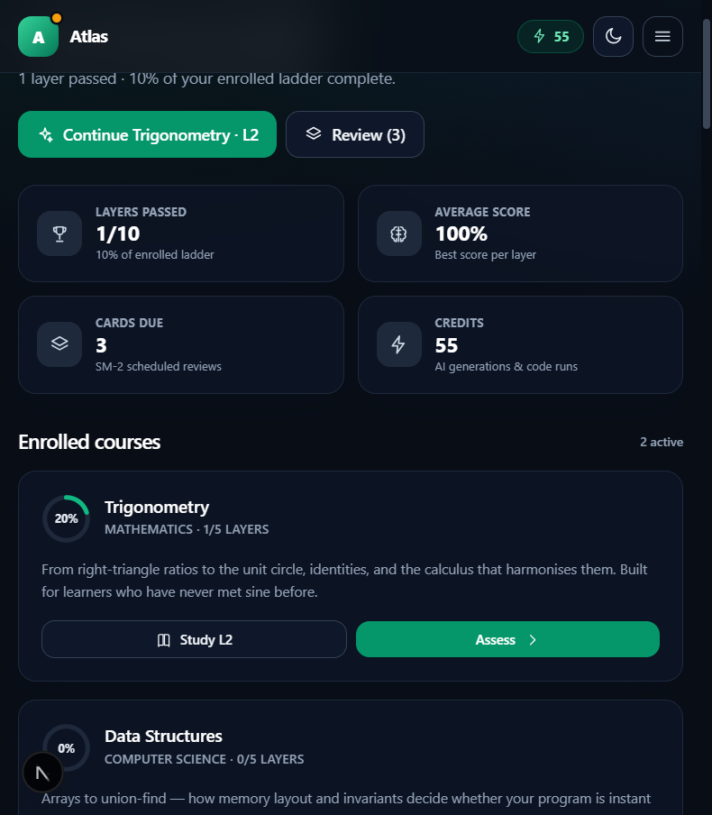
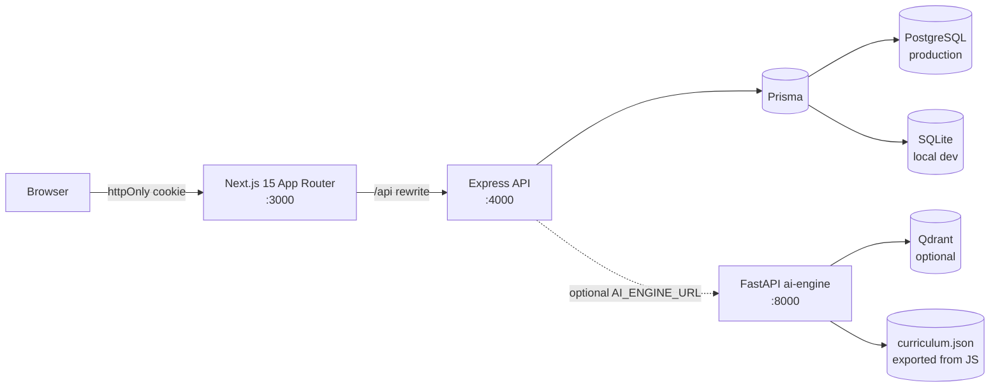

# Atlas — Adaptive Socratic EdTech Tutor

Atlas is a full-stack tutoring platform that refuses to skip the foundations. Every subject is a
strictly ordered ladder of five layers: it opens with the absolute basics and only unlocks advanced
material after the learner passes a timed assessment at **75%** or higher.

The AI tutor, **Atlas**, is grounded in a curated curriculum rather than improvised: lessons, worked
examples, reference tables, Mermaid diagrams, checkpoints, and exam variants all come from the same
source of truth. A deterministic Socratic engine makes the platform work with no API key and no
external service; an optional Python engine can enrich it (and add hybrid retrieval) without ever
contradicting the curriculum.



---

## What is implemented

| Area | Behaviour |
| --- | --- |
| **Deep curriculum** | 8 courses × 5 layers: Trigonometry, Calculus, Linear Algebra, Data Structures, Algorithms, Operating Systems, Machine Learning, Tech Ethics. Every layer starts from zero, with 4 concepts, intuition, a worked example, a reference table, a Mermaid diagram, 3 pitfalls, and an applied checkpoint. |
| **Auth portal** | Username + password, bcrypt (12 rounds), JWT in an httpOnly cookie, edge middleware protecting `/`, `/chat`, `/assessment`, `/srs`. Registration provisions 60 credits. |
| **Dashboard** | Catalogue + enrollment/de-enrollment, interactive skill tree, progress analytics, selective layer deletion, full reset, retest triggers, credit tracker, SRS shortcuts, recent attempts. |
| **Atlas workspace** | Dedicated chat at `/chat`, layer-by-layer lessons, markdown tables, KaTeX math, Mermaid diagrams rendered client-side, clickable checkpoint cards, code sandbox. |
| **Assessments** | Server-generated 8-question variants (seed-based), tiered timers (18 / 30 / 48 min), full-screen secure mode, integrity telemetry, 75% gate, dynamic retest variants, remediation on failure. |
| **SRS** | SM-2 scheduler; passing a layer seeds its concepts; reviews adjust interval/ease and earn credits (capped). |
| **Credits** | Atomic conditional debits, audit log for every movement, mastery reward (+8), daily allowance (+5), review reward (+1, max 5/day). |
| **Code execution** | JavaScript, Python, C, C++, Java; isolated temp dir, 8s timeout, bounded output, refund when a toolchain is missing, production opt-in gate. |
| **AI engine (optional)** | FastAPI service with the same layer contract, hybrid retrieval (BM25 + hashed dense + rerank, optional Qdrant), hierarchical document ingestion, retest generator, sandbox bridge. |

---

## Quick start (zero external services)

Requirements: **Node 18.17+**. Python is optional.

```bash
npm install
cp server/.env.example server/.env      # then set JWT_SECRET
# .env.example already points DATABASE_URL at SQLite (file:./dev.db)
npm run setup                           # SQLite dev schema + Prisma client + seed
npm run dev                             # API :4000 + Next.js :3000
```

Open http://localhost:3000 and create an account, or use the seeded demo account:

```
username: atlas_demo
password: AtlasDemo123
```

The demo account is only created when `SEED_DEMO=true` (already set in the local `server/.env`).

### PostgreSQL (the deployable schema)

`server/prisma/schema.prisma` targets PostgreSQL and uses native `JSON` columns. Local SQLite
development is generated from it automatically (`server/prisma/schema.dev.prisma`) with JSON stored
as text; `server/db.js` bridges the difference via `toJson`/`fromJson`.

```bash
docker compose up -d postgres
cp server/.env.example server/.env
# set DATABASE_URL and JWT_SECRET
npm run setup:postgres
npm run dev
```

`docker compose up -d qdrant` additionally starts Qdrant if you want the Python engine's managed
hybrid store.

---

## Architecture



The Next.js rewrite keeps every request first-party, so the session cookie is sent to the API
without CORS workarounds and the middleware can gate pages by cookie presence. The API re-verifies
the JWT signature and loads the user on every protected request.

```
/edtech-socratic-tutor
├── package.json                 # npm workspaces + one-command setup
├── docker-compose.yml           # PostgreSQL + Qdrant
├── server/
│   ├── index.js                 # Express app, CORS, error mapping
│   ├── db.js                    # Prisma singleton + JSON-as-text bridge
│   ├── credits.js               # atomic debit/grant + audit log
│   ├── sandbox.js               # multi-language runner
│   ├── progressService.js       # lock recalculation, selective delete, reset
│   ├── seed.js                  # idempotent catalogue seed (+ demo account)
│   ├── prisma/schema.prisma     # PostgreSQL schema
│   ├── atlas/
│   │   ├── curriculum.js        # course aggregation + policy constants
│   │   ├── courses/*.js         # the 8 curricula (the content source of truth)
│   │   ├── tutor.js             # lesson, overview, Socratic reply, remediation
│   │   ├── quiz.js              # seeded variant generator + grader
│   │   └── random.js            # deterministic RNG helpers
│   ├── routes/                  # auth, courses, progress, assessment, srs, tutor, sandbox
│   ├── scripts/                 # dev-schema bridge, curriculum export, smoke test
│   └── tests/                   # node:test unit suite
├── client/
│   ├── src/middleware.ts        # route protection
│   ├── src/lib/                 # typed API wrapper, shared types
│   ├── src/components/          # ThemeToggle, AuthForm, ChatInterface, CodeMathBlock,
│   │                            # CodeSandbox, SkillTreeView, CourseManager,
│   │                            # ProgressTracker, CreditTracker, AssessmentView
│   └── src/app/                 # login, signup, dashboard, chat, assessment, srs
└── ai-engine/                   # optional FastAPI orchestration service
    ├── socratic_pipeline.py     # lessons, dialogue, retests, sandbox bridge
    ├── vector_store.py          # hybrid retrieval (+ Qdrant when configured)
    ├── ingestion.py             # hierarchical semantic chunking
    └── data/curriculum.json     # exported from the JS curriculum
```

---

## Pedagogy and policy

**The ladder.** Layer 1 assumes nothing. Layer N+1 is `LOCKED` until layer N is `PASSED`. Atlas will
not generate a lesson for a locked layer — the API returns `403 LAYER_LOCKED` rather than quietly
teaching out of order. Deleting a module recalculates locks so later layers cannot remain open
behind a broken prerequisite chain.

**Assessments.** Each paper has 8 questions and a pass mark of 6 (75%):
concept → definition, definition → concept, boundary (a term from another layer), prerequisite,
documented pitfall, and the layer's applied checkpoint. Options and distractors are seeded, so a
retest is a genuinely new variant. Answer keys never leave the server; the client receives prompts
and options only.

| Tier | Layers | Timer | Cost |
| --- | --- | --- | --- |
| Foundation | 1–2 | 18 min | 3 credits (4 for a retest) |
| Intermediate | 3–4 | 30 min | 3 (4) |
| Advanced | 5 | 48 min | 3 (4) |

**Secure mode.** The runner requests full screen and logs `visibility_hidden`, `fullscreen_exit`,
`escape_pressed`, and `copy_attempt` as infractions. Three flag the paper; five end the attempt and
grade it as a fail. `window_blur` is logged but deliberately **not** counted — notifications and
devtools focus changes are not cheating. Submission is server-timed; overtime is flagged.

**Credits.** New accounts start at 60. Costs: 1 per message, 2 per layer lesson, 2 per code run,
3 per assessment, 4 per retest. Rewards: +8 per passed layer, +1 per review (max 5/day), +5 daily
allowance. Debits are a single conditional `UPDATE ... WHERE credits >= amount`, so parallel
requests can never produce a negative balance; every movement is written to `AuditLog`.

**SRS.** SM-2: `< 3` resets repetitions, sets a 1-day interval, and drops ease by 0.2; `>= 3` moves
1 day → 6 days → `round(interval × ease)`. Ease is floored at 1.3. Passed layers seed one card per
concept (unique per user/course/front).

---

## API surface

| Method | Path | Purpose |
| --- | --- | --- |
| POST | `/api/auth/signup` · `/login` · `/logout` | Session lifecycle |
| GET | `/api/auth/me` | Identity + stats |
| POST | `/api/auth/allowance` | Daily +5 credits |
| GET | `/api/courses` · `/api/courses/:slug` | Catalogue + per-layer state |
| POST/DELETE | `/api/courses/:slug/enroll` | Enrollment |
| GET | `/api/progress` | Dashboard aggregate |
| DELETE | `/api/progress/module/:id` | Selective module deletion |
| POST | `/api/progress/reset` | Full reset (`{ "confirm": "RESET" }`) |
| POST | `/api/assessment/start` | New (or retest) variant |
| GET | `/api/assessment/:id` | Resume an attempt |
| POST | `/api/assessment/:id/event` | Integrity telemetry |
| POST | `/api/assessment/:id/submit` | Grading + unlock + remediation |
| GET | `/api/srs` | Due deck + stats |
| POST | `/api/srs/:cardId/review` | SM-2 grade |
| POST | `/api/tutor/lesson` | Layer lesson (2 credits). `layer` optional — defaults to the current unlocked layer |
| POST | `/api/tutor/message` | Socratic reply (1 credit) |
| GET | `/api/tutor/course/:slug` | Course overview |
| POST | `/api/sandbox/run` | Execute code (2 credits) |

---

## Optional Python engine

```bash
cd ai-engine
python -m venv .venv && . .venv/Scripts/activate    # Windows
pip install -r requirements.txt
python -m uvicorn main:app --port 8000
```

Then set `AI_ENGINE_URL=http://localhost:8000` in `server/.env` and restart the API. If the engine
is unreachable, the server logs one warning and falls back to its local engine — availability never
depends on it.

Endpoints: `/health`, `/courses`, `/lesson`, `/overview`, `/message`, `/retest`, `/execute`,
`/srs/preview`. The curriculum is loaded from `data/curriculum.json`, regenerated with:

```bash
node server/scripts/export-curriculum.mjs
```

`vector_store.py` uses a dependency-free hybrid index (BM25 + hashed dense vectors + lexical
rerank) by default, or Qdrant with named dense/sparse vectors and RRF fusion when `QDRANT_URL` is
set. `ingestion.py` parses Markdown/text/PDF and produces heading-aware chunks:

```bash
python ingestion.py notes.md --course trigonometry --index
```

Optional LLM enrichment is opt-in (`ATLAS_LLM_ENRICH=true`, `OPENAI_API_KEY`) and is constrained to
the retrieved curriculum context.

---

## Verification

```bash
cd server && npm test          # curriculum contract, quiz determinism, 75% boundary, SM-2
cd client && npx tsc --noEmit  # strict TypeScript
cd client && npx next build    # production build
cd server && npm run smoke     # live end-to-end against http://localhost:4000
```

The smoke test signs up a disposable learner (cleaned up afterwards, so it never touches demo
data), generates a lesson through the Python engine when one is reachable, confirms a locked layer
is refused, starts an attempt, verifies the answer key is not on the wire, submits the key read from
the database, and checks unlock + flashcard seeding + SM-2 scheduling + reset confirmation + the
code sandbox.

---

## Security notes and production checklist

- Passwords are bcrypt-hashed; the API never returns them. Login uses one error for unknown user and
  wrong password (no account enumeration).
- Sessions are JWTs in `httpOnly`, `SameSite=Lax` cookies, marked `Secure` in production. Set a
  strong `JWT_SECRET` (≥ 32 random bytes) and serve over HTTPS.
- CORS is restricted to `CLIENT_ORIGIN` with credentials. JSON bodies are capped at 256 KB.
- The code sandbox runs on the API host. It is bounded (no shell, temp directory, 8s timeout) but
  **not** a security boundary. In production it refuses to run unless `SANDBOX_ALLOW=true`; put it
  behind a container/microVM and never expose it to untrusted users on the API host.
- Assessment answers live server-side; grading is never client-trusted. Integrity events are
  append-only audit records.
- For production: PostgreSQL via `npm run setup:postgres`, Prisma migrations rather than `db push`,
  a reverse proxy, rate limiting at the edge, and `SEED_DEMO=false`.

### Known limitations

- The default tutor is deterministic and curriculum-bound. It is excellent at teaching the mapped
  layers and deliberately refuses to invent facts outside them; connect the Python engine and an LLM
  for open-ended enrichment.
- Prisma's SQLite connector has no native `JSON`, hence the generated dev schema stores those columns
  as text. The PostgreSQL schema keeps native JSON.
- Qdrant hybrid retrieval is optional and not required for any core flow.
- `window_blur` telemetry is logged but not penalised, by design.
